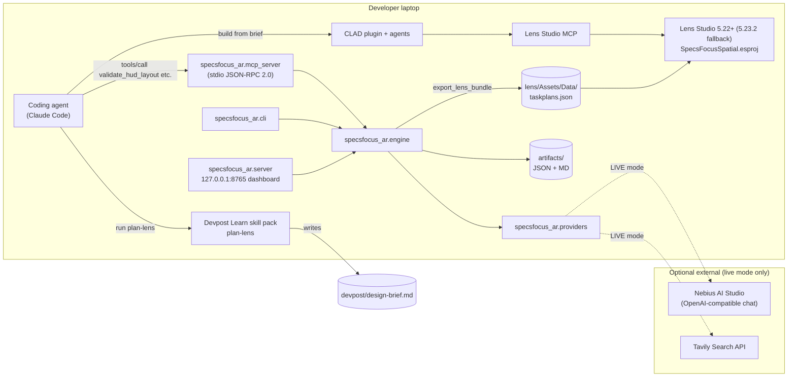
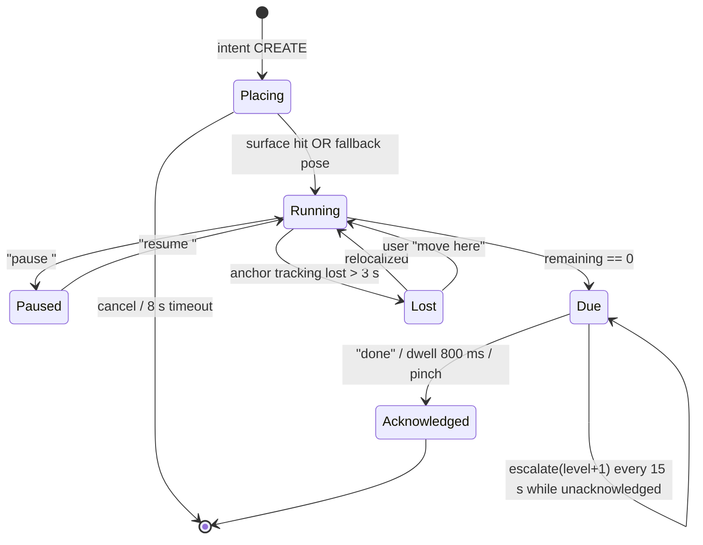
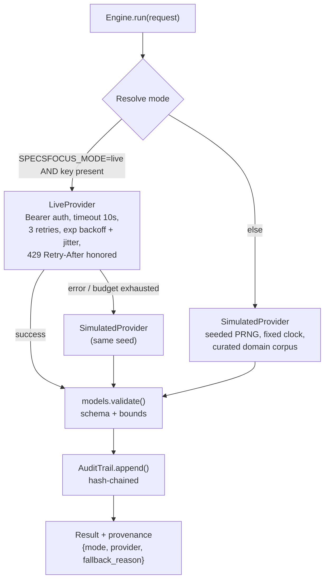

# SpecsFocus Spatial: Architecture & Implementation Design Specification

**Document:** `DESIGN_OPUS55.md`
**Project:** SpecsFocus Spatial, a hands-free AR task and timer HUD for Snap SPECS
**Companion Python package:** `specsfocus_ar`
**Hackathon:** Learn AR with SPECS (Devpost × Snap Inc.)
**Submission deadline:** 2026-11-09 17:00 EST = **2026-11-10 07:00 JST**
**Author:** Kazutoshi Hayashi (`cal29292929`)
**License:** MIT
**Document status:** v1.0, authored 2026-10-27

---

## 0. Spec Reconciliation Notes (read first)

The project brief and the official hackathon pages disagree in a few places. This spec follows the **official rules** wherever they conflict, because eligibility and judging depend on them.

| # | Brief says | Official source says | Resolution in this spec |
|---|---|---|---|
| R1 | "Main Prize Pool ($5,000)" | $2,500 total: 1st $1,250, 2nd $750, 3rd $500 | Target **1st Place ($1,250)**. Every eligible submitter also gets the Devpost Learn badge and Discord role. |
| R2 | Criteria: Technological Implementation, Design, Potential Impact, Quality of Idea | Criteria: **Design, Technical Implementation, Innovation/Idea, Presentation** | §1 maps all four official criteria. The brief's "Potential Impact" is folded into Design and Presentation (the pitch must state the problem, the audience, and why it matters). |
| R3 | Python package as a core deliverable | The Lens must be **planned with the skill pack and built by an AI agent through CLAD + Lens Studio MCP**. "Can I build without the AI agent? No." | The **Lens is the product**. `specsfocus_ar` is a **companion design-verification and content toolkit** that the coding agent calls over MCP while CLAD builds the Lens. It never replaces CLAD. |
| R4 | `NEBIUS_API_KEY`, `TAVILY_API_KEY`, `YOUCAM_API_KEY` | No external APIs are required | Nebius (LLM step decomposition) and Tavily (reference-timing lookup) are **optional live providers**. **YouCam (Perfect Corp beauty/makeup AR) does not fit a task/timer HUD**, so it is registered as a disabled provider slot and never called. Simulation mode is the default and covers the full experience. |
| R5 | `devpost/design-brief.md` | The skill pack writes the planning docs to `devpost/` | Those docs are **produced by running `plan-lens`**. This spec defines what the brief must contain (§2.2) but does not ghost-write it. Hand-authoring the brief would weaken the "planned with the skill pack" requirement. |
| R6 | Attribution handle `cal29292929` | — | Used exactly as given. Check that it matches the GitHub/Devpost handle on the submission. |

Pre-existing code disclosure: the Lens Studio SPECS Base Template, the Spectacles Interaction Kit (SIK), and any Snap sample assets are disclosed in `README.md › Disclosures`. All project code is written during the Submission Period (2026-10-15 → 2026-11-09).

---

## 1. Executive Summary & Judging Criteria Alignment

### 1.1 The problem

People doing hands-busy, eyes-up work need timers and step lists, but every current tool pulls them away from the task. Typical users:

- home cooks running three pans at once
- makers at a workbench waiting on glue, resin, or solder flux
- lab and darkroom workers following timed protocols
- people with ADHD working through multi-step routines

A phone timer means wet hands on glass and eyes on a screen. A voice-assistant timer is invisible, so "which one was the pasta?" becomes a guessing game. A floating to-do panel is just "a website in front of your face", which is the anti-pattern this hackathon calls out by name.

### 1.2 The product

**SpecsFocus Spatial puts each timer where its task physically happens and keeps the next step at the edge of your vision.**

- **Draws in the world.** You say *"Pasta, nine minutes, here"* while looking at the back burner. A ring timer pins itself to the surface you are looking at. Three timers end up on three pans, with no labels to cross-reference.
- **Leaves your body free.** The core loop needs no hands: voice to create and dismiss timers, gaze-dwell to focus one. Pinch is an optional accelerator, never a requirement.
- **Shares your view.** A timer only escalates (pulse, then chime, then follow) if it is outside your view when it finishes. Timers you can already see stay quiet.
- **Respects attention.** The HUD shows at most one peripheral "Next step" chip. Timers stay quiet and world-locked until they need you.

### 1.3 Official judging criteria → concrete features

| Official criterion | What judges look for | SpecsFocus feature(s) | Evidence in submission |
|---|---|---|---|
| **Design** | A complete, coherent product, not a tech demo | End-to-end loop: plan → place → run → escalate → complete → session summary. World-locked timers at real scale. Attention budget (≤1 head-locked element). Escalation ladder. Empty, error, and "lost anchor" states are designed, not left blank. | Video segments 2–4; `devpost/` brief; §3.4 interaction spec |
| **Technical Implementation** | Build quality; use of CLAD, Lens Studio, Lens Studio MCP | The Lens is built by CLAD agents from the brief. The coding agent uses the Lens Studio MCP for scene edits and the `specsfocus_ar` MCP server to **validate layouts against SPECS comfort rules before writing them into the scene**. LEAF tests cover voice and hand flows. Typed TS components with unit-tested pure logic. | Video segment 5 (agent building); repo `lens/`, `tests/`, `artifacts/leaf/` |
| **Innovation/Idea** | Novelty; difference from existing concepts | Most AR timer concepts are floating panels. This one uses **spatially indexed timers**, **visibility-aware escalation**, and a **quantified attention budget** (glance metrics computed by the companion engine and used as a design constraint). | §5.3 metrics; dashboard top-down view |
| **Presentation** | Clear end-to-end video; problem, audience, and why it matters | A 2:50 scripted video (§9) that opens on the three-pan problem, shows the Lens in the Lens Studio preview, then shows the design process (skill-pack interview → brief → CLAD build → MCP validation). | YouTube (public), Devpost description |

Brief-requested criteria, mapped for completeness:

| Brief criterion | Mapped to |
|---|---|
| Technological Implementation | Technical Implementation (above) |
| Design | Design (above) |
| Potential Impact | The Design "coherent product" story plus the Presentation "why it matters" line. Accessibility angle: executive-function support, no-touch use in kitchens and labs. |
| Quality of Idea | Innovation/Idea (above) |

### 1.4 Success criteria (definition of done)

1. The Lens runs in the Lens Studio preview, consistently and as shown in the video (rules §4 *Functionality*).
2. The full core loop works with **voice only** in the preview's simulated input. Pinch is optional.
3. `python -m specsfocus_ar.cli demo` finishes in **< 5 s** with zero credentials and zero network access.
4. `python -m unittest discover -s tests` passes offline.
5. The repo is public and contains `lens/*.esproj`, `devpost/`, `specsfocus_ar/`, `tests/`, `LICENSE` (MIT), and `README.md` with disclosures.
6. The video is public on YouTube and under 3:00.

---

## 2. System Architecture & Data Flow

### 2.1 Context: what runs where



**Key architectural decision (ADR-001): the Lens makes no network calls at runtime.**
All task-plan content is pre-baked into a bundled JSON asset by `export_lens_bundle`. This gives:

- (a) preview reliability for the video and judging
- (b) zero PII egress from the glasses
- (c) no Internet Module or experimental-API permission friction

Live providers only enrich content at **authoring time** on the laptop.

### 2.2 Planning pipeline (required by rules)

```
plan-lens (skill pack interview)
  └─► devpost/design-brief.md   (+ any other files the skill writes to devpost/)
        └─► CLAD agents read brief ─► Lens Studio MCP edits scene & scripts
              └─► coding agent calls specsfocus_ar MCP tools to:
                    • lint_design_brief      (brief covers the required AR design checks)
                    • validate_hud_layout    (placements obey comfort/FOV rules)
                    • plan_task              (step/timer content for demo routines)
                    • export_lens_bundle     (writes lens/Assets/Data/taskplans.json)
                    • simulate_session       (attention metrics → fed back into brief revisions)
```

When the `plan-lens` interview runs, the brief should capture these decisions, because they are the ones the judges probe:

1. Who is the user and what are their hands doing?
2. What does the camera or world context add? (Answer: placement on surfaces, plus visibility-aware escalation.)
3. What is world-locked and what is head-locked? (Timers are world-locked. Only the "Next step" chip is head-locked.)
4. What is the primary input? (Voice, with gaze-dwell as backup and pinch as optional.)
5. What failure states exist? (ASR miss, no surface hit, anchor drift, two timers finishing at once.)

### 2.3 Lens-side component architecture (TypeScript, built via CLAD)

```
lens/
├── SpecsFocusSpatial.esproj
└── Assets/
    ├── Data/taskplans.json              # generated by export_lens_bundle (schema §3.2)
    ├── Prefabs/TimerRing.prefab         # world-locked ring + label + progress arc
    ├── Prefabs/NextStepChip.prefab      # single head-locked peripheral chip
    └── Scripts/
        ├── core/TimerModel.ts           # pure logic: state machine, no Lens APIs (unit-testable)
        ├── core/EscalationPolicy.ts     # pure logic: visibility × overdue → level
        ├── core/IntentParser.ts         # pure logic: transcript → Intent (mirrors Python grammar)
        ├── VoiceCommandRouter.ts        # ASR module → IntentParser → controllers
        ├── PlacementController.ts       # gaze ray + world query hit test → anchor pose
        ├── TimerAnchorComponent.ts      # binds TimerModel to a TimerRing instance
        ├── TimerRegistry.ts             # owns all timers; tick loop; max 6 concurrent
        ├── VisibilityProbe.ts           # in-frustum + angle-from-gaze test per timer
        ├── NextStepChipController.ts    # attention budget: ≤1 head-locked element
        ├── GazeDwellSelector.ts         # 800 ms dwell focus (hands-free fallback)
        ├── PinchShortcuts.ts            # SIK pinch: optional confirm/dismiss
        ├── SessionStore.ts              # persistent storage of active timers (restart-safe)
        └── SessionSummary.ts            # end-of-session panel (completed, overdue seconds)
```

API binding notes. CLAD picks the exact module names; verify them against the current SPECS docs during the build.

| Concern | SPECS facility (expected) | Fallback if unavailable in preview |
|---|---|---|
| Voice | ASR module (on-device speech recognition) | Preview keyboard text input routed into `IntentParser` |
| Surface placement | World Query / hit-test module | Place at 1.2 m along gaze at the eye-height offset of the last valid hit |
| Hands | Spectacles Interaction Kit (pinch, poke) | Preview's simulated hand / mouse |
| Persistence | Persistent storage system | In-memory only, with the loss surfaced in the session summary |
| Audio chime | Audio component | Visual-only escalation |

### 2.4 Interaction state machine (per timer)



Escalation ladder (`EscalationPolicy`). The input is `visible` (the timer is inside the view frustum and within 30° of gaze) and `overdue_s`:

| Level | Condition | Rendering |
|---|---|---|
| 0 | Running | Ring arc only, 40% opacity |
| 1 | Due ∧ visible | Ring pulses, full opacity. No sound. |
| 2 | Due ∧ ¬visible | Soft chime plus an edge arrow on the Next-step chip pointing toward the timer |
| 3 | Due ∧ overdue_s ≥ 30 | Chip turns amber and shows "Pasta: 0:30 over". Chime every 15 s. |
| 4 | overdue_s ≥ 120 | Chip is replaced by a lazy-follow reminder card (still the only head-locked element) |

### 2.5 Dual-mode execution (companion toolkit)



Mode resolution rules:

| `SPECSFOCUS_MODE` | Keys present | Effective mode | Note |
|---|---|---|---|
| unset / `auto` | none | `simulated` | Default for judges and CI |
| unset / `auto` | some | `live` for providers that have keys, `simulated` for the rest | Per-provider resolution |
| `simulated` | any | `simulated` | Forces determinism even when keys exist |
| `live` | missing | **error** `E_CONFIG_MISSING_KEY` | Fails fast. Live mode never silently degrades unless fallback is allowed. |
| `live` + `SPECSFOCUS_ALLOW_FALLBACK=1` | any | live, with per-call fallback | `provenance.fallback_reason` is recorded |

Every result carries `provenance`, so the dashboard and artifacts always show which mode produced which data.

### 2.6 External API schemas (live mode)

#### 2.6.1 Nebius AI Studio: step decomposition (OpenAI-compatible)

- Base URL is configurable through `NEBIUS_BASE_URL` (default `https://api.studio.nebius.com/v1`). Confirm the current endpoint in your Nebius console, since the product naming has changed over time.
- Model is configurable through `NEBIUS_MODEL`.

Request `POST {NEBIUS_BASE_URL}/chat/completions`:

```json
{
  "model": "${NEBIUS_MODEL}",
  "temperature": 0,
  "seed": 1729,
  "max_tokens": 800,
  "response_format": {"type": "json_object"},
  "messages": [
    {"role": "system", "content": "You decompose hands-busy physical tasks into AR HUD steps. Output JSON matching schema TaskPlanDraft v1. Max 12 steps. Each step label <= 32 chars. Durations in whole seconds. No personal data."},
    {"role": "user", "content": "{\"goal\":\"Carbonara for 2\",\"domain\":\"kitchen\",\"max_parallel_timers\":3}"}
  ]
}
```

Headers: `Authorization: Bearer ${NEBIUS_API_KEY}`, `Content-Type: application/json`, `User-Agent: specsfocus_ar/1.0`.

Expected response (subset consumed):

```json
{
  "id": "chatcmpl-…",
  "choices": [{"message": {"role": "assistant",
    "content": "{\"steps\":[{\"label\":\"Boil salted water\",\"duration_s\":480,\"anchor_hint\":\"back-left burner\",\"parallel_group\":\"A\"}]}"}}],
  "usage": {"prompt_tokens": 142, "completion_tokens": 311}
}
```

`choices[0].message.content` is parsed with `json.loads` and then **strictly validated** into `TaskPlan` (§3.2). Invalid JSON or schema violations count as a provider error, which triggers fallback (if allowed) with `fallback_reason="schema_invalid"`.

#### 2.6.2 Tavily: reference timing lookup

Request `POST https://api.tavily.com/search`:

```json
{
  "query": "typical al dente cooking time spaghetti minutes",
  "search_depth": "basic",
  "max_results": 3,
  "include_answer": true
}
```

Headers: `Authorization: Bearer ${TAVILY_API_KEY}`. The key goes in a header, never in the body or the URL.

Consumed fields: `answer` (string) and `results[].url` (citation only). The engine extracts candidate durations with the regex `(\d{1,3})\s*(?:-|–|to)?\s*(\d{1,3})?\s*min` and uses them only to **sanity-bound** LLM or simulated durations (clamp to ±50% of the median reference). Source URLs are stored in `provenance.citations`.

#### 2.6.3 YouCam: disabled slot

`YOUCAM_API_KEY` is read so that `.env` parity is maintained, and then ignored. `providers.registry["youcam"]` is `DisabledProvider(reason="out_of_domain: beauty/makeup AR APIs are not used by a task/timer HUD")`. Tests assert that it is never invoked.

#### 2.6.4 Generic HMAC signing (optional relay)

For teams that front the providers with their own relay, `RelayProvider` signs requests:

```
X-SF-Timestamp: <unix seconds>
X-SF-Signature: hex(HMAC_SHA256(SPECSFOCUS_RELAY_SECRET, f"{ts}\n{method}\n{path}\n{sha256_hex(body)}"))
```

The server side rejects requests where |now − ts| > 300 s. `hmac.compare_digest` is used for verification.

---

## 3. Domain Model

### 3.1 Core entities

```mermaid
classDiagram
  class TaskPlan { +str plan_id; +str title; +Domain domain; +list~Step~ steps; +int schema_version; +Provenance provenance }
  class Step { +str step_id; +str label; +int duration_s; +str anchor_hint; +str parallel_group; +list~str~ depends_on }
  class TimerSpec { +str timer_id; +str label; +int duration_s; +Pose anchor; +AnchorKind kind }
  class Pose { +float x; +float y; +float z; +float yaw_deg }
  class HudElement { +str element_id; +ElementKind kind; +Lock lock; +Pose pose; +float width_m; +float height_m }
  class HudLayout { +list~HudElement~ elements; +Viewer viewer }
  class SessionEvent { +int t_ms; +EventKind kind; +str timer_id; +dict data }
  class SessionMetrics { +int glance_count; +float mean_glance_s; +float heads_down_ratio; +int overdue_s_total; +float attention_load; +int comfort_violations }
  class AuditRecord { +int seq; +str ts; +str action; +str input_sha256; +str output_sha256; +str prev_hash; +str hash }
  TaskPlan "1" *-- "many" Step
  HudLayout "1" *-- "many" HudElement
```



### 3.2 `taskplans.json`: Lens bundle schema (v1)

This is the contract between the Python toolkit and the Lens. `IntentParser.ts` and `TimerModel.ts` consume it.

```json
{
  "schema_version": 1,
  "generated_by": "specsfocus_ar 1.0.0",
  "generated_mode": "simulated",
  "plans": [
    {
      "plan_id": "kitchen-carbonara-2",
      "title": "Carbonara for 2",
      "domain": "kitchen",
      "steps": [
        {"step_id": "s1", "label": "Boil salted water", "duration_s": 480, "anchor_hint": "back burner", "parallel_group": "A", "depends_on": []},
        {"step_id": "s2", "label": "Crisp guanciale",   "duration_s": 420, "anchor_hint": "front pan",   "parallel_group": "B", "depends_on": []},
        {"step_id": "s3", "label": "Cook spaghetti",    "duration_s": 540, "anchor_hint": "back burner", "parallel_group": "A", "depends_on": ["s1"]}
      ]
    }
  ],
  "voice_grammar": {
    "create":  ["{label} {n} minutes here", "timer {n} minutes {label}", "start {label}"],
    "ack":     ["done", "got it", "{label} done"],
    "pause":   ["pause {label}"],
    "resume":  ["resume {label}"],
    "move":    ["move {label} here"],
    "next":    ["next step", "what's next"]
  }
}
```

### 3.3 Validation rules (`models.py`, enforced on construction)

| Field | Rule | Error code |
|---|---|---|
| `*_id` | `^[a-z0-9][a-z0-9\-]{0,63}$` | `E_INVALID_ID` |
| `label` | 1–32 chars after NFC normalization and strip. No control chars. No `<>`. | `E_INVALID_LABEL` |
| `duration_s` | int, 5 ≤ d ≤ 14 400 (4 h) | `E_DURATION_RANGE` |
| `steps` | 1–12 entries, unique `step_id`, `depends_on` refers to existing ids, acyclic (Kahn's algorithm) | `E_STEP_GRAPH` |
| concurrent timers | ≤ 6 per session (visual clutter cap) | `E_TOO_MANY_TIMERS` |
| `Pose` | finite floats; ‖(x,y,z)‖ ≤ 10 m | `E_POSE_RANGE` |
| `HudElement.lock=head` | ≤ 1 per layout (attention budget) | `E_ATTENTION_BUDGET` |
| `domain` | enum {kitchen, workshop, lab, routine} | `E_INVALID_DOMAIN` |
| `goal` (free text in) | ≤ 200 chars; PII scrubbed (§7.3) before any provider call | `E_INPUT_TOO_LONG` |

Every model implements `to_dict()`, `from_dict(d, *, strict=True)`, and `to_json()`. `to_json()` produces canonical output: `sort_keys=True, separators=(",", ":"), ensure_ascii=False`. Strict mode rejects unknown keys (`E_UNKNOWN_FIELD`).

### 3.4 Comfort rules (`validate_hud_layout`)

The defaults come from Snap's SPECS design best-practices and positioning-and-sizing guides. They are kept in `ComfortProfile` so they can be tuned without code changes. **Re-check the values against the current docs during the build.**

| Rule | Default | Rationale |
|---|---|---|
| `min_distance_m` | 0.5 | Below this, vergence-accommodation discomfort |
| `preferred_distance_m` | 1.0–1.6 | Comfortable reading zone for world-locked UI |
| `max_distance_m` | 6.0 | Labels unreadable beyond this at the default size |
| `fov_diag_deg` | 46 | Display FOV. Head-locked content must sit fully inside. |
| `head_locked_max_offset_deg` | 18 | Keep the chip in the near periphery, not the centre |
| `min_text_angular_height_deg` | 0.9 | Legibility floor |
| `max_vertical_angle_deg` | ±35 | Limits neck strain for content the user has to look at repeatedly |
| `max_head_locked` | 1 | Attention budget |

---

## 4. Module-by-Module Specification

The package targets **Python ≥ 3.10, standard library only**. There is no `requirements.txt` beyond an optional `dev` extra, so judges and CI have nothing to install.

### 4.1 `specsfocus_ar/__init__.py`

```python
"""SpecsFocus Spatial companion toolkit: design verification, task-plan
generation, and attention simulation for the SpecsFocus Spatial SPECS Lens.

Author: Kazutoshi Hayashi (cal29292929). License: MIT.
"""
__version__ = "1.0.0"
__author__ = "Kazutoshi Hayashi"
__license__ = "MIT"

from .models import TaskPlan, Step, TimerSpec, Pose, HudElement, HudLayout, SessionMetrics
from .engine import Engine, EngineConfig

__all__ = ["TaskPlan", "Step", "TimerSpec", "Pose", "HudElement", "HudLayout",
           "SessionMetrics", "Engine", "EngineConfig", "__version__"]
```

Importing the package has **no side effects**: no `.env` loading, no network access, no logging configuration.

### 4.2 `specsfocus_ar/models.py`

Responsibilities: dataclasses, enums, strict validation, canonical serialization, and the error type.

```python
class ValidationError(ValueError):
    def __init__(self, code: str, field: str, message: str): ...
    def to_dict(self) -> dict: return {"code": self.code, "field": self.field, "message": self.message}

@dataclass(frozen=True, slots=True)
class Step:
    step_id: str
    label: str
    duration_s: int
    anchor_hint: str = ""
    parallel_group: str = "A"
    depends_on: tuple[str, ...] = ()
    def __post_init__(self): _check_id(self.step_id); _check_label(self.label); _check_duration(self.duration_s)
```

Design points:

- Use `frozen=True` dataclasses and tuples instead of lists. Immutability makes audit hashing sound.
- `Provenance(mode: Literal["live","simulated"], provider: str, seed: int | None, fallback_reason: str | None, citations: tuple[str, ...])`.
- `canonical_json(obj) -> bytes` is the single serialization path, used for hashing, artifacts, and HTTP responses.
- Implement `TaskPlan.topological_order() -> tuple[Step, ...]` and `TaskPlan.critical_path_s() -> int`. The critical path is the longest dependency chain, with steps in the same `parallel_group` serialized.

### 4.3 `specsfocus_ar/providers.py`

```python
class Provider(Protocol):
    name: str
    def decompose(self, goal: str, domain: Domain, *, seed: int) -> TaskPlanDraft: ...
    def reference_durations(self, query: str) -> ReferenceTimings: ...

class HttpClient:
    """urllib-based JSON client. Timeout, retry, and auth only; no domain logic."""
    def __init__(self, *, timeout_s=10.0, max_retries=3, backoff_base_s=0.5, backoff_cap_s=8.0,
                 rate_limiter: TokenBucket, clock: Clock, sleep: Callable[[float], None]): ...
    def post_json(self, url: str, body: dict, *, auth: Auth) -> dict: ...
```

**Retry policy**

| Condition | Action |
|---|---|
| `URLError`, `TimeoutError`, `ConnectionResetError` | Retry |
| HTTP 408, 425, 500, 502, 503, 504 | Retry |
| HTTP 429 | Sleep `Retry-After` (seconds or HTTP-date, capped at 30 s), then retry. This sleep does not consume backoff budget. |
| HTTP 400, 401, 403, 404, 422 | **No retry**. Raise `ProviderError(code="E_PROVIDER_4XX")`. 401/403 is reported as `E_AUTH` with the key redacted. |
| Backoff formula | `min(cap, base * 2**attempt) * (0.5 + rng.random()/2)`. The jitter `rng` is seeded, so tests are deterministic. |
| Response body | Capped at 1 MiB. Content-Type must be JSON. |

**Auth**

`BearerAuth(env_var)` reads the key lazily from the isolated `Secrets` object (§7.1), never from `os.environ` directly. `HmacAuth(secret_env)` is described in §2.6.4. `Auth.__repr__` always returns `"<redacted>"`.

**Rate limiting**

`TokenBucket(rate_per_s=2, burst=4)` is kept per provider, with an injectable clock.

**Simulated provider**

`SimulatedProvider` is the high-fidelity fallback:

- **Corpus.** `specsfocus_ar/data/corpus.json` (package data) holds 16 curated plans: kitchen ×6, workshop ×4, lab ×3, routine ×3. They have realistic durations, for example: pasta 540 s, rice 1080 s, 5-min epoxy cure 300 s, PCR denature 30 s, darkroom developer 480 s. Each includes anchor hints and parallel groups.
- **Matching.** Token overlap (Jaccard) between the normalized goal and the plan title and tags. Ties break on `plan_id`.
- **Deterministic variation.** `seed = int.from_bytes(sha256(f"{goal}|{domain}|{base_seed}").digest()[:8], "big")`, then `rng = random.Random(seed)`. Durations are jittered by ±10% and rounded to 15 s. The same input always produces the same output on every platform.
- **Reference timings** come from the corpus `reference_ranges` table, with `citations=("simulated:corpus",)`.

`DisabledProvider` raises `ProviderError("E_PROVIDER_DISABLED")` on any call.

`build_registry(config, secrets) -> dict[str, Provider]` performs the mode resolution in §2.5.

### 4.4 `specsfocus_ar/engine.py`

The engine handles orchestration, metrics, the agentic workflow, and the audit trail.

```python
@dataclass(frozen=True)
class EngineConfig:
    mode: Literal["auto", "live", "simulated"] = "auto"
    allow_fallback: bool = False
    seed: int = 1729
    comfort: ComfortProfile = ComfortProfile()
    artifacts_dir: Path = Path("artifacts")

class Engine:
    def __init__(self, config: EngineConfig, *, providers=None, clock: Clock = SystemClock()): ...
    def plan_task(self, goal: str, domain: str) -> Result[TaskPlan]: ...
    def validate_hud_layout(self, layout: HudLayout) -> Result[LayoutReport]: ...
    def simulate_session(self, plan: TaskPlan, *, scenario: str = "default", duration_s: int | None = None) -> Result[SessionReport]: ...
    def export_lens_bundle(self, plans: list[TaskPlan], out_path: Path) -> Result[BundleInfo]: ...
    def lint_design_brief(self, markdown: str) -> Result[BriefLintReport]: ...
    def run_workflow(self, goal: str, domain: str) -> Result[WorkflowReport]: ...
    @property
    def audit(self) -> AuditTrail: ...
```

#### 4.4.1 Multi-step agentic workflow (`run_workflow`)

| Step | Operation | Gate (abort or repair on failure) |
|---|---|---|
| 1 | `scrub_pii(goal)` → normalized goal | Length ≤ 200 |
| 2 | `provider.decompose` → `TaskPlanDraft` | Strict schema validation |
| 3 | `provider.reference_durations` for each step that has a timer | Clamp outliers to ±50% of the reference median and record a `repair` event |
| 4 | Build `TaskPlan`, check the DAG, compute the critical path | No cycles. ≤ 6 parallel timers at any instant (sweep-line over the schedule). |
| 5 | Auto-generate `HudLayout`: timers on a simulated counter arc at 1.2 m, chip at 15° down-right | `validate_hud_layout`. On failure, apply **one** repair pass (pull into the comfort band, then re-validate). |
| 6 | `simulate_session(plan, scenario="default")` | `attention_load ≤ 0.6`, else add a `warning` |
| 7 | Emit `WorkflowReport` plus audit records | — |

Each step appends an `AuditRecord`. Repairs are explicit events and never silent changes.

#### 4.4.2 Session simulator

This is a discrete-event simulation with an injected clock and a 100 ms resolution.

- **Gaze model.** An attention-switching process. The user mostly looks at the "active task" (the earliest-due running timer's anchor) and saccades to other anchors at a Poisson rate λ = 0.15/s (the scenario can change this).
- **Behaviour model.** When a timer is due, the user acknowledges it after a delay. If the timer is visible, the delay is drawn from LogNormal(μ=ln 3, σ=0.5). If it is not visible, it equals the escalation-level delay plus a LogNormal sample.
- **Baseline comparison.** The same plan is replayed under a **phone-timer baseline**: every check-in is a heads-down glance of 2.5 s, and alarms are non-localized, which costs a 4 s "which one?" disambiguation.

Scenarios: `default`, `busy_kitchen` (λ=0.3, 4 parallel timers), `distracted` (25% of acknowledgments delayed by 60 s), `anchor_loss` (one anchor lost for 20 s at t=200 s).

#### 4.4.3 Quantitative metrics (`SessionMetrics`)

| Metric | Definition |
|---|---|
| `glance_count` | Number of gaze dwells ≥ 200 ms on any HUD element |
| `mean_glance_s` | Mean dwell duration across those glances |
| `heads_down_ratio` | Seconds with gaze pitch < −35° ÷ session seconds (phone baseline is dominated by this) |
| `overdue_s_total` | Σ over timers of (ack_time − due_time)⁺ |
| `disambiguation_s` | Seconds spent finding *which* timer fired (≈0 when timers are world-anchored) |
| `attention_load` | `0.4·norm(glance_count/min) + 0.3·norm(mean_glance_s) + 0.3·heads_down_ratio`, where `norm(x) = x/(x+k)` with k calibrated so the phone baseline ≈ 0.7 |
| `comfort_violations` | Count of layout-rule breaches observed during the session |
| `improvement_vs_baseline` | Per-metric relative delta against the phone-timer replay |

These numbers appear in the dashboard and the CLI report and drive one 10-second segment of the video. They are **simulation estimates**, labelled as such everywhere. Nobody should mistake them for user-study results.

#### 4.4.4 Audit trail

`AuditTrail` is an append-only, hash-chained list:

```
hash_n = sha256(prev_hash_{n-1} || canonical_json(record_without_hash))
```

Records store **hashes of inputs and outputs, not raw free text**, which supports the zero-PII-retention rule. `verify() -> bool` recomputes the chain. In simulated mode, timestamps come from the injected clock, so audit hashes are reproducible.

#### 4.4.5 `lint_design_brief`

The engine parses Markdown headings and keywords and checks that the brief covers the following. Each check reports pass, warn, or missing with a suggestion. **It does not rewrite the brief.**

1. Target user and context
2. What the camera or world adds
3. World-locked vs head-locked decisions
4. Primary input and hands-free path
5. Comfort and placement
6. Failure states
7. Success criteria for the demo

### 4.5 `specsfocus_ar/mcp_server.py`

This is a JSON-RPC 2.0 server that implements the MCP tool surface. **Transports:**

- `stdio`: newline-delimited JSON messages. This is the default and is how the coding agent launches it.
- `http`: `POST /mcp` on the dashboard server.

Protocol version negotiation: the server advertises `"2025-06-18"` and accepts the client's version if it is in its supported set.

**Agent registration (Claude Code):**

```bash
claude mcp add specsfocus -- python -m specsfocus_ar.mcp_server --stdio
```

**Supported methods:** `initialize`, `notifications/initialized`, `ping`, `tools/list`, `tools/call`.

**Tools (5):**

| Tool | Input schema (JSON Schema, abridged) | Output |
|---|---|---|
| `plan_task` | `{goal: string ≤200, domain: enum}` | `TaskPlan` + provenance |
| `validate_hud_layout` | `{elements: HudElement[] ≤16, viewer?: Pose}` | `{ok, violations[{rule, element_id, measured, limit, fix}]}` |
| `simulate_session` | `{plan_id? \| plan?, scenario?: enum, seed?: int}` | `SessionReport` (metrics + baseline + timeline summary) |
| `export_lens_bundle` | `{plan_ids: string[] ≤16, out_path?: string}` | `{path, sha256, bytes}`. `out_path` must resolve under `lens/Assets/Data/` (§7.2). |
| `lint_design_brief` | `{path?: string \| markdown?: string ≤64KiB}` | `BriefLintReport` |

**Example exchange:**

```json
{"jsonrpc":"2.0","id":3,"method":"tools/call",
 "params":{"name":"validate_hud_layout","arguments":{"elements":[
   {"element_id":"chip","kind":"next_step_chip","lock":"head","pose":{"x":0.35,"y":-0.30,"z":-1.0,"yaw_deg":0},"width_m":0.18,"height_m":0.05},
   {"element_id":"t-pasta","kind":"timer_ring","lock":"world","pose":{"x":-0.4,"y":-0.35,"z":-0.3,"yaw_deg":0},"width_m":0.12,"height_m":0.12}]}}}
```

```json
{"jsonrpc":"2.0","id":3,"result":{"content":[{"type":"text","text":"{\"ok\":false,\"violations\":[{\"rule\":\"min_distance_m\",\"element_id\":\"t-pasta\",\"measured\":0.62,\"limit\":0.5,\"fix\":null},{\"rule\":\"head_locked_max_offset_deg\",\"element_id\":\"chip\",\"measured\":24.6,\"limit\":18,\"fix\":{\"x\":0.25,\"y\":-0.21}}]}"}],
 "structuredContent":{"ok":false,"violations":[…]},"isError":false}}
```

**Error mapping.** Protocol errors use JSON-RPC codes:

| Code | Meaning |
|---|---|
| `-32700` | Parse error |
| `-32600` | Invalid request |
| `-32601` | Method not found |
| `-32602` | Invalid params, including schema violations, with `data: ValidationError.to_dict()` |
| `-32603` | Internal error (message genericized, details only in the debug log) |

Domain failures, such as a provider being down with fallback disabled, return `result.isError: true`. This follows MCP convention, so the agent can read the error and recover.

**Limits:** messages ≤ 256 KiB, 30 s per-call timeout, batch requests rejected. The server never writes to stdout except protocol frames. Logs go to stderr.

### 4.6 `specsfocus_ar/server.py`

This is a zero-dependency HTTP server (`http.server.ThreadingHTTPServer`) that serves the REST API and the single-page dashboard.

```bash
python -m specsfocus_ar.server --host 127.0.0.1 --port 8765
```

**REST API**

| Method | Path | Body / Query | Response |
|---|---|---|---|
| GET | `/healthz` | — | `{"status":"ok","version":"1.0.0","mode":"simulated"}` |
| GET | `/api/plans` | — | `{"plans":[{plan_id,title,domain,critical_path_s}]}` |
| POST | `/api/plan` | `{goal, domain}` | `TaskPlan` |
| POST | `/api/validate` | `HudLayout` | `LayoutReport` |
| POST | `/api/simulate` | `{plan_id, scenario, seed?}` | `SessionReport` |
| POST | `/api/workflow` | `{goal, domain}` | `WorkflowReport` |
| GET | `/api/audit` | — | `{records:[…], verified: bool}` |
| POST | `/mcp` | JSON-RPC 2.0 | JSON-RPC 2.0 (same dispatcher as stdio) |
| GET | `/` | — | Dashboard HTML (inline JS and CSS, no CDN) |

Errors use the envelope `{"error":{"code":"E_…","message":"…","field":"…"}}` with HTTP 400, 404, 413, 415, 429, or 500.

**Hardening**

- Binds `127.0.0.1` by default. `--host 0.0.0.0` requires an explicit `--i-understand-exposure` flag.
- `Content-Length` is required and ≤ 256 KiB, otherwise 413. `Content-Type: application/json` is required for POST, otherwise 415.
- Per-IP token bucket (10 req/s, burst 20). Over the limit returns 429 with `Retry-After`.
- Response headers: `Content-Security-Policy: default-src 'self'; script-src 'self' 'nonce-…'; style-src 'self' 'nonce-…'; img-src 'self' data:`, plus `X-Content-Type-Options: nosniff`, `Referrer-Policy: no-referrer`, `Cache-Control: no-store`.
- No CORS headers, so cross-origin browsers are blocked by default.
- All user strings are rendered with `textContent`, never `innerHTML`.

**Dashboard panels (single page)**

1. **Top-down room view** (Canvas 2D). Viewer at the origin, the FOV wedge, comfort bands (0.5 m / 1.0–1.6 m rings), timer anchors as coloured rings, and the chip as a square. Violations are outlined in red, with the suggested fix shown as a ghost.
2. **Session timeline.** Swimlanes per timer (running / due / ack) and a gaze trace, with a scrubber.
3. **Metrics card.** SpecsFocus vs the phone baseline with delta arrows, labelled *"simulated estimate"*.
4. **Workflow log.** Seven steps with pass/repair/warn badges and provenance chips (`SIMULATED` / `LIVE · nebius`).
5. **Audit chain** with a ✓ verified indicator.

### 4.7 `specsfocus_ar/cli.py`

```
python -m specsfocus_ar.cli demo                     # full workflow on 3 showcase goals, < 5 s, offline
python -m specsfocus_ar.cli plan "Carbonara for 2" --domain kitchen
python -m specsfocus_ar.cli validate layout.json
python -m specsfocus_ar.cli simulate --plan kitchen-carbonara-2 --scenario busy_kitchen --seed 7
python -m specsfocus_ar.cli export --plans kitchen-carbonara-2,workshop-epoxy-glueup --out lens/Assets/Data/taskplans.json
python -m specsfocus_ar.cli lint-brief devpost/design-brief.md
```

Global flags: `--mode {auto,live,simulated}`, `--allow-fallback`, `--seed INT`, `--artifacts DIR`, `--json` (machine output to stdout).

**Artifacts** (written atomically via a temp file followed by `os.replace`):

```
artifacts/
├── demo_<seed>/workflow_<plan_id>.json
├── demo_<seed>/session_<plan_id>_<scenario>.json
├── demo_<seed>/REPORT.md          # human summary: plans, layout checks, metrics table, provenance
└── demo_<seed>/audit.jsonl
```

Exit codes:

| Code | Meaning |
|---|---|
| 0 | OK |
| 2 | Usage error |
| 3 | Validation failure |
| 4 | Provider failure (fallback disabled) |
| 5 | Audit verification failed |

### 4.8 `tests/` (stdlib `unittest`, offline by default)

| File | Coverage |
|---|---|
| `test_models.py` | Every validation rule in §3.3, including boundary values (4/5/14400/14401 s, 32/33-char labels, a cyclic DAG, a second head-locked element). Round-trip `from_dict(to_dict(x)) == x`. Canonical JSON stability. Unknown-field rejection. |
| `test_providers.py` | Simulated determinism: same input gives identical bytes across 100 runs. A different seed gives different output. Retry on 503 then success. 429 honours `Retry-After` (fake sleep records durations). No retry on 401. The 1 MiB cap. The key never appears in `repr`, exceptions, or logs (assert via a captured log handler). YouCam slot is never invoked. HMAC signature vector test. Live tests are skipped unless `SPECSFOCUS_LIVE_TESTS=1`. |
| `test_engine.py` | Workflow happy path. Outlier clamping produces a `repair` event. Layout auto-repair converges in one pass. Timer cap enforced. Metrics are stable for a fixed seed (golden JSON in `tests/golden/`). SpecsFocus beats the baseline on `disambiguation_s` and `heads_down_ratio` in all four scenarios. Audit chain verifies, and tampering with any record makes `verify()` return False. |
| `test_security.py` | PII scrubber (emails, phone-like digit runs, URLs with query strings) applied before the provider call (spy provider). Path traversal on `export_lens_bundle` (`../`, absolute paths, symlink escape) rejected. Oversized inputs rejected. Unicode edge cases (RTL override, zero-width chars, NFC/NFD) handled. `.env` parsing ignores `export`, quotes, and comments and never mutates `os.environ`. |
| `test_mcp_server.py` | `initialize` handshake. `tools/list` returns 5 tools with valid JSON Schemas. `tools/call` for each tool. `-32700/-32600/-32601/-32602` mapping. Batch rejected. Stdout contains only protocol frames (subprocess test). |
| `test_http_api.py` | Starts the server on port 0 in a thread. Each endpoint returns the expected status and shape. 413/415/429 paths. Security headers present. No CORS header. `/` serves HTML containing a CSP nonce. |
| `test_perf.py` | `cli demo` completes in < 5 s wall-clock (asserted with headroom: < 4 s on CI). |

Run: `python -m unittest discover -s tests -v`. CI (GitHub Actions) runs the matrix py3.10–3.13 on ubuntu-latest, with no secrets configured. That proves simulated mode is self-sufficient.

**Lens-side tests:**

- `core/*.ts` pure-logic modules get a tiny Node test harness (`lens/tests/*.test.mjs`, run with `node --test`). It checks that `IntentParser` and `EscalationPolicy` agree with their Python mirrors on a shared fixture file, `tests/fixtures/intents.json`.
- **LEAF** scenarios cover: voice create → place → due → ack; anchor loss → "move pasta here"; two timers due at the same time. Results are exported to `artifacts/leaf/`.

---

## 5. Lens Experience Specification (what CLAD builds)

### 5.1 Core loop (voice-only path)

1. **Launch.** A dim "Say a task and a time, or *'start carbonara'*" hint appears for 4 s, then fades. No panel greets the user.
2. **Create.** *"Pasta nine minutes here."* The gaze reticle shows the surface hit. The ring materializes on the surface, scaled to 12 cm. A soft confirmation tick plays.
3. **Plan mode.** *"Start carbonara."* The chip shows "1/3 · Boil salted water · place: back burner". The user looks at the burner and says *"here"*, and the timer is placed. The chip advances.
4. **Run.** Timers sit quietly at level 0. Gaze-dwelling 800 ms on any ring expands it to show the label and mm:ss. It collapses after 3 s once the gaze leaves.
5. **Due.** The escalation ladder (§2.4) runs. *"Pasta done"* or *"done"* (which applies to the most recently escalated timer) acknowledges it.
6. **End.** *"Finish session"* shows a summary card: tasks completed, total overdue time. It dismisses itself after 10 s.

### 5.2 Designed failure states

| Failure | Response |
|---|---|
| ASR no-match | Chip shows "Didn't catch that. Try: *pasta 9 minutes here*" for 3 s. Nothing modal. |
| No surface hit | Fallback pose at 1.2 m along gaze, with a dashed ring meaning "floating". The user can say *"move pasta here"*. |
| Anchor lost | Ring greys out. The chip shows "Pasta: re-place?" The timer **keeps counting** regardless. |
| Two timers due at once | Both pulse. The chip lists both. *"done"* acknowledges the one nearest to gaze. |
| More than 6 timers | Voice reply: "Six timers is the limit. Finish one first." |

### 5.3 Why this is not "a website in front of your face"

- Zero always-on panels. The default view is the real world plus small rings on real objects.
- Information is **spatially indexed**: *where* the timer is tells you *what* it is for.
- Head-locked content is capped at one element, in the periphery, and the toolkit validates this rule.

---

## 6. Repository Layout

```
specsfocus-spatial/
├── README.md                  # pitch, demo link, quick start, disclosures, attribution
├── LICENSE                    # MIT, © 2026 Kazutoshi Hayashi
├── DESIGN_OPUS55.md           # this document
├── devpost/                   # written by plan-lens (design-brief.md + any companion files)
├── lens/
│   ├── SpecsFocusSpatial.esproj
│   ├── Assets/…               # CLAD-built scene, prefabs, scripts, Data/taskplans.json
│   └── tests/*.test.mjs
├── specsfocus_ar/
│   ├── __init__.py  models.py  providers.py  engine.py
│   ├── mcp_server.py  server.py  cli.py
│   └── data/corpus.json
├── tests/  (+ golden/, fixtures/)
├── artifacts/                 # gitignored except artifacts/sample/ (one committed demo run)
├── .env.example               # key NAMES only, empty values
├── .gitignore                 # .env, artifacts/*, !artifacts/sample
└── .github/workflows/ci.yml
```

---

## 7. Security, Privacy & Reliability

### 7.1 Credential isolation

- `Secrets.load(path=".env")` is a minimal parser written for this project (`KEY=VALUE`, optional quotes, `#` comments, optional `export ` prefix). It returns an **immutable mapping** and **does not modify `os.environ`**, so child processes cannot inherit keys.
- Only the allow-listed names are read: `NEBIUS_API_KEY`, `NEBIUS_BASE_URL`, `NEBIUS_MODEL`, `TAVILY_API_KEY`, `YOUCAM_API_KEY` (read, unused), `SPECSFOCUS_RELAY_SECRET`, `SPECSFOCUS_MODE`, `SPECSFOCUS_ALLOW_FALLBACK`. Other keys are ignored.
- Keys exist only inside `Auth` objects. `__repr__` and `__str__` redact them. A logging filter scrubs anything matching a loaded secret value (exact match) or `Bearer\s+\S+`.
- `.env` is gitignored. CI includes a pre-commit-style check that fails the build if a tracked file matches `(?i)(api[_-]?key|secret)\s*=\s*\S{12,}`.
- Keys are sent **only** in `Authorization` headers to their own provider's host. Hosts are allow-listed per provider, and redirects to other hosts are refused.

### 7.2 Input validation and path safety

- All entry points (CLI, REST, MCP) go through the same `models.from_dict(strict=True)` path. Inputs are validated once.
- File outputs are resolved with `Path.resolve()` and must satisfy `is_relative_to(allowed_root)`. Allowed roots are `artifacts/` and `lens/Assets/Data/`. Symlinks are resolved before the check.
- `lint_design_brief(path=…)` reads only from inside `devpost/`.

### 7.3 Privacy (zero PII retention)

- **The Lens makes no network calls (ADR-001) and keeps no camera frames.** Surface hits and gaze come from on-device tracking. Only poses and timer labels are persisted, locally.
- Free-text goals pass through `scrub_pii`, which redacts emails, phone-like digit sequences (≥ 7 digits), and URLs, **before** any live provider call.
- The audit trail stores SHA-256 digests of inputs and outputs, not raw text. Artifacts contain plans, which are domain content and not user data.
- No analytics or telemetry of any kind.
- Attribution in code, docs, and the LICENSE is limited to **name, handle, and MIT license**. No personal address, phone number, email, or unrelated organizational names appear anywhere in the repo.

### 7.4 Reliability and reproducibility

| Concern | Mechanism |
|---|---|
| Upstream flakiness | Bounded retries, 10 s timeouts, per-provider token bucket, `Retry-After` honoured |
| Silent degradation | Fallback only with an explicit opt-in. `provenance.fallback_reason` is always recorded and shown. |
| Determinism | Seeded `random.Random` (never the module-level RNG), injected clock, canonical JSON, golden-file tests |
| Demo safety | Simulated mode is the default. The Lens bundle is pre-baked, so the video does not depend on any network. |
| Time budget | `cli demo` < 5 s. Corpus loaded once with `functools.cache`. No sleeps in simulated mode. |

---

## 8. Delivery Plan (today: 2026-10-27)

| Date (ET) | Milestone |
|---|---|
| Oct 27 | Lens Studio SPECS Base Template saved as `lens/SpecsFocusSpatial.esproj`. CLAD and Lens Studio MCP connected. Run `plan-lens` and commit `devpost/`. |
| Oct 28 | `models.py`, `providers.py` (simulated), `engine.py` core, corpus. Tests green. |
| Oct 29 12:00 | Attend the **live build session**. Then the first CLAD build: voice create → world-locked ring. |
| Oct 30–Nov 1 | MCP server wired into the agent. CLAD iterations: placement, escalation, chip, failure states. Bundle export. |
| Nov 2–3 | Dashboard, CLI artifacts, LEAF scenarios, live providers (optional). |
| Nov 4 | Post to #devpost-learn-feedback tagged "Learn AR with SPECS" and "Will It Ship". |
| Nov 5 12:00 | Attend the **live project review**. Collect feedback. |
| Nov 6–7 | Apply feedback. Polish. Freeze the feature set. |
| Nov 8 | Record and edit the video. Write the README and Devpost description. |
| **Nov 9 by 12:00 ET** | **Submit** (5 h buffer before the 17:00 EST / Nov 10 07:00 JST deadline). Verify the repo is public and the video is public. |

---

## 9. Presentation: Video Script (target 2:50, hard cap < 3:00)

| Time | Segment | Shows |
|---|---|---|
| 0:00–0:15 | Problem | Three pans, wet hands, phone timer: "Which one was the pasta?" |
| 0:15–0:25 | Promise | "SpecsFocus puts every timer where its task happens, hands-free." |
| 0:25–1:25 | Lens working (preview) | Voice create and place, plan mode with 3 timers on 3 surfaces, gaze-expand, due while visible (quiet pulse), due while out of view (chime + edge arrow), "done" |
| 1:25–1:45 | Failure states | Anchor loss → "move pasta here". ASR miss hint. |
| 1:45–2:25 | Design process | `plan-lens` interview excerpt → `devpost/design-brief.md` → CLAD agents building in Lens Studio → agent calling `validate_hud_layout` and fixing a too-close timer |
| 2:25–2:40 | Evidence | Dashboard: top-down view and the metrics card vs the phone baseline (labelled simulated) |
| 2:40–2:50 | Close | Who it is for (cooks, makers, lab workers, ADHD routines), what was learned ("world-locked beats head-locked; one peripheral element is enough"), repo link |

---

## 10. Devpost Description Skeleton

**What it does.** SpecsFocus Spatial pins hands-free timers to the real objects they belong to: the pot, the glue-up, the sample tray. A single peripheral chip shows your next step. Timers stay quiet when you can see them and escalate only when you can't.

**Who it's for.** Anyone doing hands-busy, eyes-up work: home cooks, makers, lab and darkroom workers, and people who rely on step-by-step routines.

**How we built it.** The Lens was planned with the Devpost Learn `plan-lens` skill and built by Claude Code through CLAD and the Lens Studio MCP. A companion MCP server (`specsfocus_ar`) let the agent validate every placement against SPECS comfort guidelines and simulate attention load before committing scene changes. It was tested in the Lens Studio preview and with LEAF.

**What we learned.** *(Fill in after the build. Candidate:)* Good AR is mostly subtraction. The design improved each time we removed a head-locked element.

**Disclosures.** Lens Studio SPECS Base Template; Spectacles Interaction Kit; *(list any other templates or assets used)*.

**Attribution.** Kazutoshi Hayashi (`cal29292929`). MIT License.
